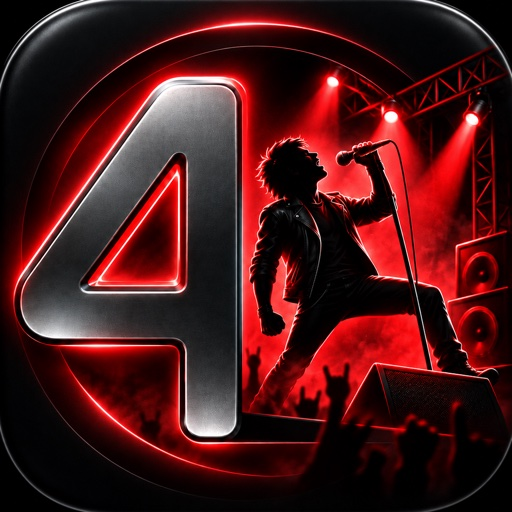
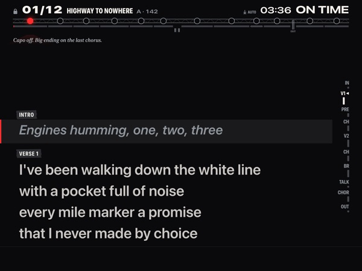
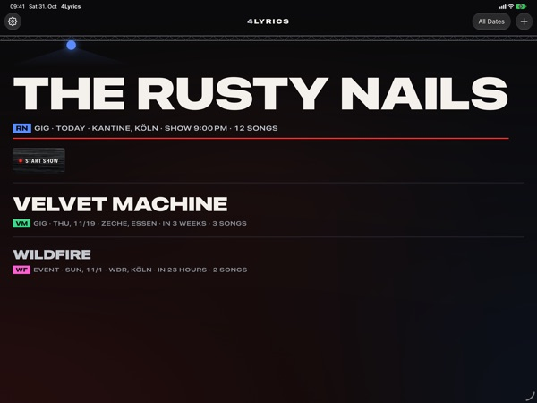
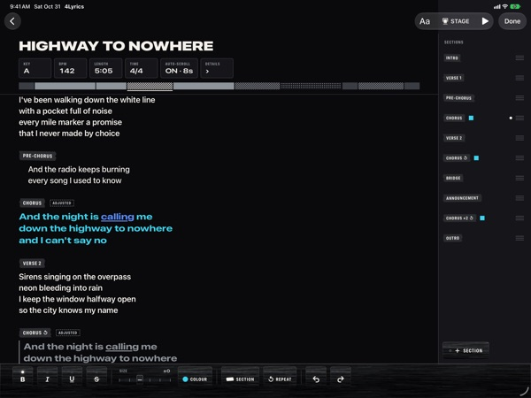
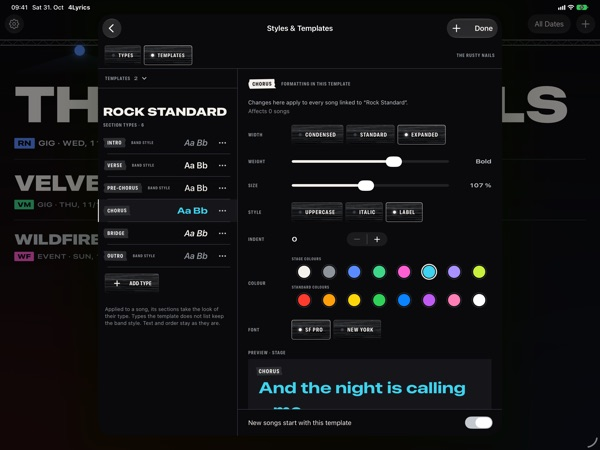
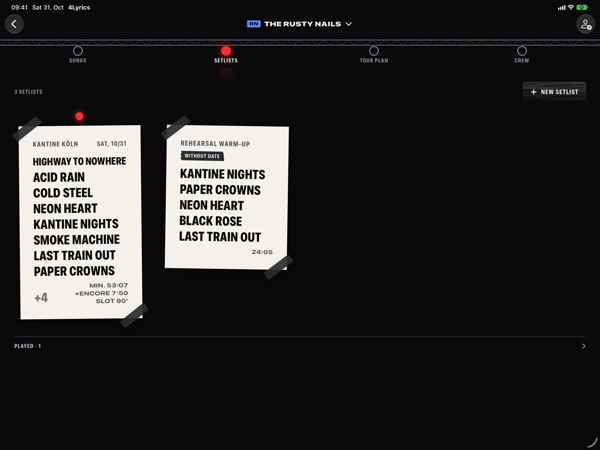
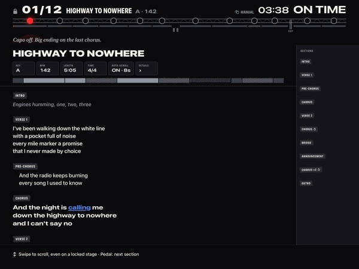
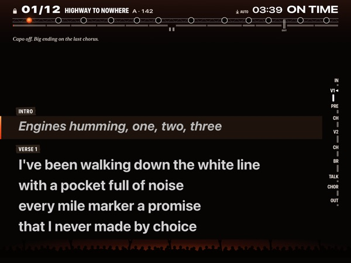
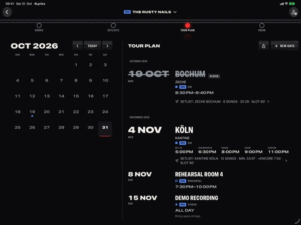

# 4Lyrics — Stage Prompter

**Setlists & live mode for bands. One red lamp shows where you are in the set.**

4Lyrics is the lyrics app for bands on stage. Songs, setlists and tour dates live in one place; the live mode shows the lyrics, your position in the set and the time against the plan. Made for the iPad on a music stand, also on iPhone and on Macs with Apple silicon.

*In review.* · [Website](https://4lyrics.app.robspace.de)

---

## What it does

- **Bands and crew** — your bands stand in a line-up like a festival poster, the next show on top. Share a band through iCloud and issue passes: a crew pass edits songs, setlists and dates, a guest pass reads and plays along. You can leave a band at any time.
- **Songs and editor** — songs are built from sections: verse, chorus, bridge, intro, talk or your own types. Each section type has one look per song, so a chorus reads as a chorus from across the stage: colour one chorus and every chorus of the song follows. Should one chorus look different, "As Own Section" makes it a type of its own. Select words to colour only those, in the stage colours or in standard colours such as red, orange and yellow. Import lyrics from text or ChordPro files.
- **Templates** — a template is a design for your band: its section types and how each one looks (width, weight, size, style, colour and font). It sets no running order and holds no lyrics. Apply it to a song and its sections take that look; linked songs follow when you change the template.
- **Setlists** — every setlist lies on the stage floor like a sheet of paper, with pauses, announcements and encores. A running-time column shows when each song starts and where your slot ends. Print a setlist as PDF.
- **Autoscroll or standard view** — each setlist decides: the lyrics glide along with the length of the song, or the standard view shows the song as if you had opened it by hand and you scroll or turn pages yourself, by finger or by pedal.
- **Live mode** — the truss hangs above the lyrics, one lamp per song, and the red lamp is now. The mini dashboard shows your position in the set, the song, the clock and whether you are early or late against the plan. Page-turner pedals that connect as a Bluetooth keyboard move on. Lock the stage when the show starts, so a stray touch changes nothing.
- **Stage light** — every light is dark. Club is the black stage with a red spot; Open Air keeps it dark with embers glowing behind the crowd and turns the screen to full brightness during the show; Red Light keeps everything red for dark stages.
- **Tour plan** — gigs, rehearsals and other dates for one band or all bands, as a month and as an agenda with the day's schedule. Export as .ics for your calendar.
- **Backup** — one file holds all your bands, songs, setlists and dates.
- **Private by design** — no account with us, no ads, no analytics, no tracking and no robspace server. iCloud is optional: it keeps your library in sync between your devices and is needed to share a band.

## Screenshots

<table>
<tr>
<td></td>
<td></td>
</tr>
<tr>
<td></td>
<td></td>
</tr>
<tr>
<td></td>
<td></td>
</tr>
<tr>
<td></td>
<td></td>
</tr>
</table>

## Specs

| | |
|---|---|
| **Platform** | iPad, iPhone, Mac with Apple silicon (as the iPad app) |
| **Minimum** | iPadOS / iOS 26 |
| **Category** | Music |
| **Price** | 30 days free with every feature, then reading, playing shows and exporting stay free; writing and editing need 4Lyrics Pro: yearly subscription (Tour) or one-time purchase (All Access), both with Family Sharing |
| **Languages** | English, German, French, Spanish, Italian |
| **Privacy** | No account, no analytics, no tracking, no robspace server; iCloud optional |

ChordPro is an open file format and not affiliated with robspace.

## File an issue for 4Lyrics

⚠️ This is a public repo — please don't post lyrics you don't want to publish or other personal data. Use placeholders.

- 🐞 [Bug report — 4Lyrics](https://github.com/RobEarth0815/robspace-apps/issues/new?labels=app%3A4lyrics%2Ctype%3Abug%2Cstatus%3Aneeds-triage&template=bug_report.yml)
- ✨ [Feature request — 4Lyrics](https://github.com/RobEarth0815/robspace-apps/issues/new?labels=app%3A4lyrics%2Ctype%3Aenhancement%2Cstatus%3Aneeds-triage&template=feature_request.yml)
- 💬 [Discuss 4Lyrics](https://github.com/RobEarth0815/robspace-apps/discussions)
- 🔍 [Browse open 4Lyrics issues](https://github.com/RobEarth0815/robspace-apps/issues?q=is%3Aopen+is%3Aissue+label%3Aapp%3A4lyrics)
