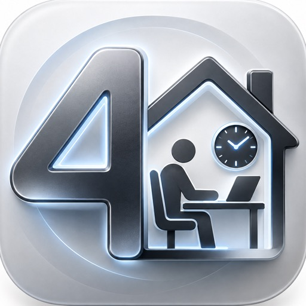

# 4Work — Time Tracking & Vacation Planning

**A time clock for people who keep track of their own working hours.**

One tap starts the day, your overtime balance is always in view, and vacation, sick days and public holidays live in one place. In the office, at home or switching between both.

[Website](https://4work.app.robspace.de)

---

## What it does

- **Time clock** — clock in and out with a tap, a Shortcut or (Pro) automatically when you arrive at or leave one of your places; break rules, Live Activity and a ring in the Dynamic Island.
- **Hours** — every day against its target, week and month, overtime balance, an optional daily-limit warning.
- **Work schedules** — weekly hours or hours per weekday, schedules that change over time, vacation days per schedule.
- **Time off** — vacation taken, planned and free, carry-over with expiry, vacation years you can correct, sick days, time off in lieu, bridge days; public holidays for every German federal state.
- **Places and goals** — home office, office, on the road; quotas such as "at least 2 office days a week" with forecast.
- **Timesheets** — monthly timesheet as PDF or CSV, automatic monthly reports, past months on request.
- **Backup**, widgets, Shortcuts and Siri.

## Specs

| | |
|---|---|
| **Platform** | iPhone (iOS 26) |
| **Languages** | English, German, French, Spanish, Italian |
| **Price** | Free; 4Work Pro as monthly or yearly subscription or one-time purchase, 30 days of Pro included |
| **Privacy** | No account, no own server, no tracking, no ads — data on the device and in your private iCloud |

## File an issue for 4Work

⚠️ This is a public repo — please don't include personal data such as addresses or working times of real people. Use placeholders.

- 🐞 [Bug report — 4Work](https://github.com/RobEarth0815/robspace-apps/issues/new?labels=app%3A4work%2Ctype%3Abug%2Cstatus%3Aneeds-triage&template=bug_report.yml)
- ✨ [Feature request — 4Work](https://github.com/RobEarth0815/robspace-apps/issues/new?labels=app%3A4work%2Ctype%3Aenhancement%2Cstatus%3Aneeds-triage&template=feature_request.yml)
- 💬 [Discuss 4Work](https://github.com/RobEarth0815/robspace-apps/discussions)
- 🔍 [Browse open 4Work issues](https://github.com/RobEarth0815/robspace-apps/issues?q=is%3Aopen+is%3Aissue+label%3Aapp%3A4work)
