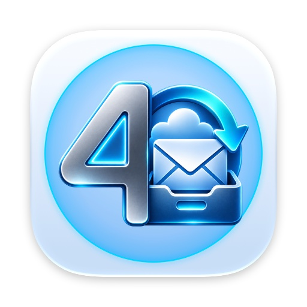

# Backup4Mail — Mail Backup with Time Travel

**Your whole mailbox, at every point in time.**

Backup4Mail is a Mac app that copies complete IMAP mailboxes from your mail server into a folder you choose: on your Mac, an external drive or a NAS. After the first backup it fetches only what has changed. Every backup becomes a point in time you can travel back to, restore and export.

*Coming to the Mac App Store.* · [Website](https://backup4mail.app.robspace.de)

---

## What it does

- **Back up** — add an account with your email address. Outlook.com, Hotmail, Live and Microsoft 365 connect with "Sign in with Microsoft"; other providers use IMAP with a password or app password (Gmail works as an ordinary IMAP account with an app password).
- **Open formats** — save as EML (one file per mail) or MBOX (one file per folder). Both open in Apple Mail, Thunderbird and many other apps, with or without Backup4Mail.
- **Built for network drives** — if the NAS sleeps or the Wi-Fi drops, your mail waits on your Mac until the destination answers again. A backup counts as finished only when all its mail has arrived.
- **Schedules** — every backup job has its own schedule: hourly, daily at a set time, weekly or manual only. From the menu bar, Backup4Mail keeps working with the window closed.
- **Read-only backups** — backing up only reads. Nothing on your mail server is marked as read, moved or deleted.
- **Time travel** — drag along the timeline and see your mailbox exactly as it was: folders, mails, read and flagged status. New, since-deleted and moved mails are marked. Search covers subject, sender, recipient and preview across all points in time.
- **Restore** — restore a whole point in time or chosen folders into the original account or a different one. A dry run shows beforehand how many mails are already there, so nothing arrives twice. Flags and dates are kept.
- **Export and import** — export any point in time as MBOX, EML folder, Maildir, PST (beta) or HTML archive, a searchable offline website that opens in any browser. Import from MBOX, EML, Maildir, PST (beta) and Apple Mail folders. Verify checks every mail against its SHA-256 fingerprint.
- **Sample mailbox** — explore every screen with fictional mail before adding your own account.

## Specs

| | |
|---|---|
| **Platform** | Mac |
| **Minimum** | macOS 26 |
| **Category** | Utilities |
| **Mail accounts** | IMAP (password or app password) and Microsoft (Outlook.com, Hotmail, Live, Microsoft 365) |
| **Price** | Free download with the full app for 30 days; then Backup4Mail Pro (monthly or yearly subscription, or one-time purchase) for new backups and time travel. Restoring, exporting and verifying always stay free. Family Sharing with every purchase |
| **Languages** | English, German, French, Spanish, Italian |
| **Privacy** | No robspace server, no analytics, no tracking, no ads; passwords stay in your Mac's keychain |

Microsoft, Outlook, Hotmail and Microsoft 365 are trademarks of the Microsoft group of companies. Gmail is a trademark of Google LLC. Apple Mail is a trademark of Apple Inc. Thunderbird is a trademark of the Mozilla Foundation. Backup4Mail is an independent app by robspace and is not affiliated with Microsoft, Google or Mozilla.

## File an issue for Backup4Mail

⚠️ This is a public repo — please don't include email addresses, mail contents, server names, passwords or other personal data. Use placeholders.

- 🐞 [Bug report — Backup4Mail](https://github.com/RobEarth0815/robspace-apps/issues/new?labels=app%3Abackup4mail%2Ctype%3Abug%2Cstatus%3Aneeds-triage&template=bug_report.yml)
- ✨ [Feature request — Backup4Mail](https://github.com/RobEarth0815/robspace-apps/issues/new?labels=app%3Abackup4mail%2Ctype%3Aenhancement%2Cstatus%3Aneeds-triage&template=feature_request.yml)
- 💬 [Discuss Backup4Mail](https://github.com/RobEarth0815/robspace-apps/discussions)
- 🔍 [Browse open Backup4Mail issues](https://github.com/RobEarth0815/robspace-apps/issues?q=is%3Aopen+is%3Aissue+label%3Aapp%3Abackup4mail)
